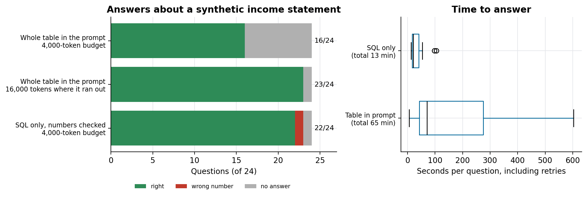

# Grounded finance agents

24 questions about a synthetic income statement, asked to an LLM two ways: with the whole table in the prompt, and through SQL only with a check that every number in the answer came from the query.

Companion code for the article **[How to stop AI agents from inventing numbers](https://lucas.rangeltech.net/articles/h7-stop-agents-inventing-numbers/)**.

## The problem

Finance questions have exact answers, and a model that is right most of the time is wrong in the cases that matter. This repository measures two ways of answering questions about an income statement with the same model.

The data is a synthetic income statement (DRE) as a small star schema in SQLite: 12 months, 4 business units, 12 accounts. Every question has a hand-written reference query, so the expected answer is known.

> All data in this repository is synthetic, generated by the scripts with a fixed seed, with the shape of a real client problem. No client data, names or code are included.

## What the code does

- **Table in the prompt:** the model receives all 576 fact rows as CSV and answers directly.
- **Query only:** the model writes one SQLite `SELECT` from the schema; the code runs it (one retry with the error message, the job of a SQL fixer agent); the model writes the answer from the returned rows; a check rejects any number in the answer that is not in the rows and falls back to printing the rows.

Any OpenAI-compatible endpoint works: set `LLM_BASE_URL`, `LLM_API_KEY` and `LLM_MODEL`.

## Results

Our run: an abliterated Qwen 27B served with vLLM (see [qwen-abliterated-api](https://github.com/LucasRangelSSouza/qwen-abliterated-api)), temperature 0.

| Approach | Right (of 24) | Wrong number | No answer | Time for the set |
|---|---:|---:|---:|---:|
| Whole table in the prompt, 4,000-token budget | 16 | 0 | 8 | 28 min |
| Whole table, 16,000 tokens for the 8 empty ones | 23 | 0 | 1 | 65 min in total |
| SQL only, numbers checked, 4,000-token budget | 22 | 1 | 1 | 13 min |

The table approach never gave a wrong number; it ran out of budget reasoning through 576 rows. The two SQL failures were queries with the wrong meaning (a change with the sign reversed, an average over rows instead of months), which a check that numbers come from the query cannot catch. Both runs are in `results/`; answers are graded with the sign required to match.



## Run it

Python 3.11 or later.

```bash
pip install -r requirements.txt
python dre.py
LLM_BASE_URL=... LLM_API_KEY=... LLM_MODEL=... python run.py results/my_run.json
python run.py --retry-empty results/my_run.json
python figures.py figures
```

## Files

| File | What it is |
|---|---|
| `dre.py` | builds `dre.sqlite`, the 24 questions and their reference queries |
| `run.py` | asks every question both ways and grades the answers; `--retry-empty` re-asks empty answers with a larger budget |
| `figures.py` | answers by approach and seconds per question |
| `results/` | our run: first pass and after the retry |

## License

Apache 2.0. See [LICENSE](LICENSE).
